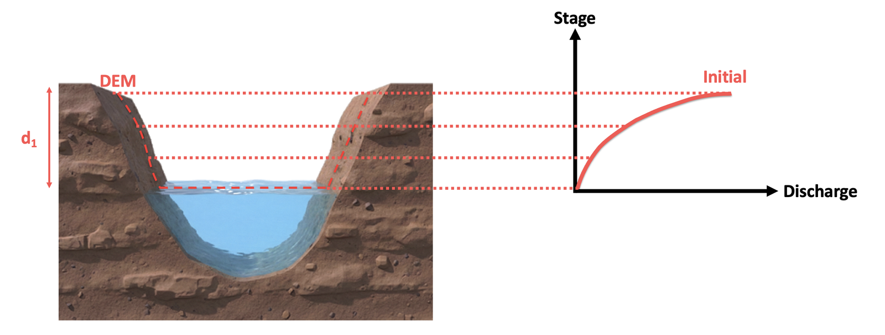
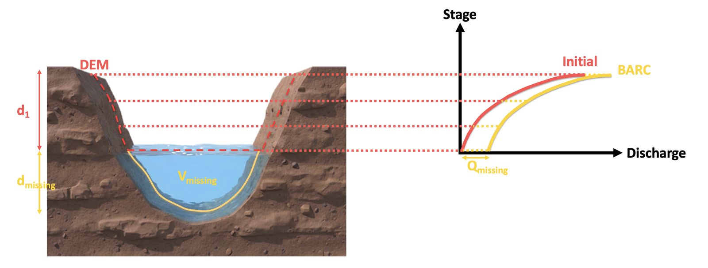
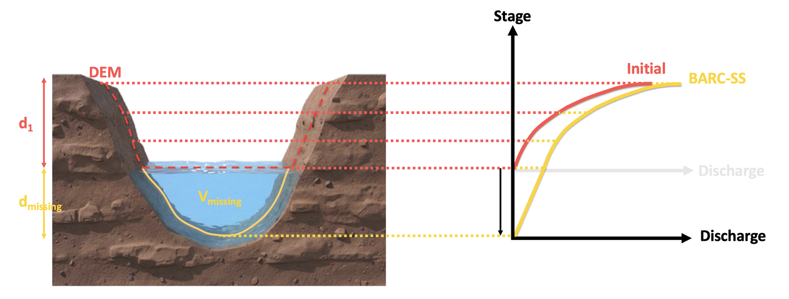
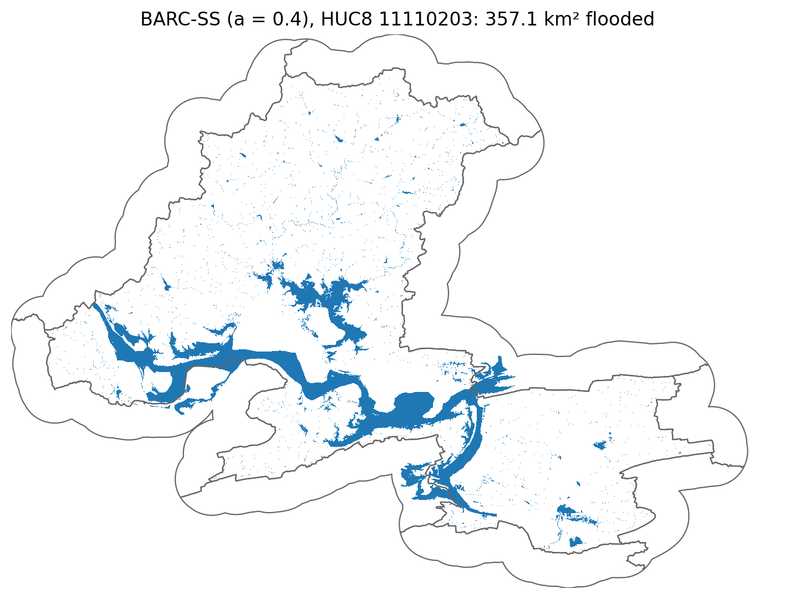

# BARC-SS: Bathymetric Adjustment of Rating Curves and Stage Shift

[](https://doi.org/10.5281/zenodo.23520164)

DEMs capture the water surface, not the river bed, so the synthetic rating curves of
[OWP HAND-FIM](https://github.com/NOAA-OWP/inundation-mapping) miss the channel below
the water. This code adds that channel to the HAND-FIM hydrotables before the flood map
is made:

- **BARC** adds the bankfull channel area and wetted perimeter to the hydrotable and
  recomputes discharge with Manning's equation.
- **BARC-SS** does the same, then shifts each rating curve's stage up by the reach's
  mean-flow depth and anchors it at zero flow.

Channel width and depth come from [HydroGeom](https://github.com/Reizrb/HydroGeom),
for a channel shape you choose.

<p align="center"><br><sub>Initial HAND-FIM: the DEM captures only the channel above the water surface.</sub></p>
<p align="center"><br><sub>BARC: the missing channel geometry is added and discharge recomputed.</sub></p>
<p align="center"><br><sub>BARC-SS: stage is also shifted by the mean-flow depth and anchored at zero flow.</sub></p>

## Run the example

The method is one file, [`barc_ss.py`](barc_ss.py). It adjusts the hydrotables of a HUC8
downloaded with [FIMserv](https://github.com/sdmlua/FIMserv), which also runs HAND-FIM.

```bash
git clone https://github.com/Reizrb/Bathymetric-Adjustment-of-Rating-Curves-and-Stage-Shift-BARC-SS
cd Bathymetric-Adjustment-of-Rating-Curves-and-Stage-Shift-BARC-SS
pip install fimserve "git+https://github.com/Reizrb/HydroGeom" contextily jupyter
jupyter notebook examples/BARC-SS_HUC8_11110203_a0.4.ipynb
```

The notebook runs **HUC8 11110203** (Arkansas River) with a **trapezoidal channel,
a = 0.4**, and the flood of **3 January 2016, 00:00** (NWM retrospective discharge, OWP
HAND-FIM 4.5). It downloads the HUC8, applies BARC-SS, plots a rating curve before and
after, runs HAND-FIM, and maps the flooded area.

<p align="center"><br><sub>Result of the example: BARC-SS flood map for HUC8 11110203, a = 0.4, 3 January 2016.</sub></p>

## Use it on any HUC8

```python
import fimserve as fm
import barc_ss

huc = "11110203"
flood_dir = f"output/flood_{huc}"

fm.DownloadHUC8(huc, version="4.5")                                   # 1. download HAND-FIM

ids = barc_ss.feature_ids(flood_dir, huc)                             # 2. reaches in the HUC8
geometry = barc_ss.channel_geometry(ids, shape="a", value=0.4)        # 3. channel geometry
barc_ss.apply_barc(flood_dir, huc, geometry, method="BARC-SS")       # 4. adjust hydrotables

fm.getNWMretrospectivedata(huc, "2015-12-26", "2016-01-05",
                           value_times=["2016-01-03 00:00:00"])      # 5. discharge
fm.runOWPHANDFIM(huc)                                                 # 6. flood map
```

| Setting | Options |
|---------|---------|
| `method` | `"BARC"` or `"BARC-SS"` |
| `shape="a"` | trapezoid, `value` = bottom width / top width (0 triangle, 1 rectangle) |
| `shape="r"` | Dingman's r, `value` = r (1 triangle, 2 parabola, larger toward rectangle) |
| `shape="z"` | side slope, `value` = z (z:1) |

| Function in `barc_ss.py` | What it does |
|--------------------------|--------------|
| `feature_ids(flood_dir, huc)` | NWM reach IDs in the HUC8's rating curves |
| `channel_geometry(ids, shape, value)` | Bankfull geometry from HydroGeom, with area and wetted perimeter for the shape |
| `apply_barc(flood_dir, huc, geometry, method)` | Apply BARC or BARC-SS to every hydrotable of the HUC8 |
| `restore_hydrotables(flood_dir)` | Put back the original hydrotables |
| `plot_rating_curve(flood_dir, huc, hydroid, discharge_csv=...)` | Original vs adjusted rating curve of one reach, with the flood discharge |
| `plot_flood_map(fim_tif, boundary_file, basemap)` | Flooded area and HUC8 boundary on a basemap (`BASEMAPS` lists six) |
| `quiet()` | Hide FIMserv's download and log messages (`with barc_ss.quiet(): ...`) |

The original hydrotables are saved in `output/flood_<huc>/original_hydrotables/` the first
time, and every run starts from them, so you can rerun with another method or shape.

## What it changes

For every stage of each reach's hydrotable, with bankfull area A<sub>bnk</sub> and
wetted perimeter P<sub>bnk</sub> for the chosen shape and reach length L (km):

| | |
|---|---|
| Volume += A<sub>bnk</sub> × L × 1000 | (1) |
| Bed area += P<sub>bnk</sub> × L × 1000 | (2) |
| Wetted perimeter P += P<sub>bnk</sub> | (3) |
| Wet area A += A<sub>bnk</sub> | (4) |
| R = A / P | (5) |
| Q = (1/n) × A × R<sup>2/3</sup> × S<sup>1/2</sup>, with n and S unchanged | (6) |
| BARC-SS only: stage += mean-flow depth | (7) |

Both methods then add a point at stage = 0, discharge = 0 at the start of each rating
curve. The HAND raster is not changed, reaches without a geometry prediction are left
as they are, and the original discharge is kept in `discharge_cms_org`.

## Citation

- Zarrabi, R., Cohen, S., Pruitt, C., Baruah, A., McDermott, R., & Chen, Y. (2026).
  Sensitivity of terrain-based flood inundation model (OWP HAND-FIM) predictions to
  channel geometry: Insights from bathymetric adjustments of rating curves and stage
  shift. *Journal of Hydrology* (under review).
- Zarrabi, R., McDermott, R., Erfani, S. M. H., & Cohen, S. (2025). Bankfull and
  mean-flow channel geometry estimation through machine learning algorithms across
  the CONtiguous United States (CONUS). *Water Resources Research*, 61(2).
  https://doi.org/10.1029/2024WR037997

## Funding

<table><tr>
<td width="110"></td>
<td>Funding for this project was provided by the National Oceanic &amp; Atmospheric Administration (NOAA), awarded to the Cooperative Institute for Research to Operations in Hydrology (CIROH) through the Cooperative Agreement with The University of Alabama (NA22NWS4320003).</td>
</tr></table>

## License

[MIT](LICENSE)
